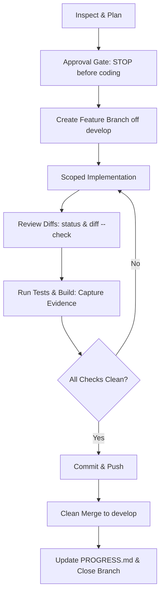

# Engineering Rules

This document establishes the binding engineering principles, coding standards, and operational invariants for the **Islamic History Atlas** project. Every human developer and AI coding agent must adhere to these rules without exception.

---

## 1. Core Engineering Rules

### Rule 1: Inspect existing code before creating anything
Never edit or generate files blindly. Read the relevant files, tests, callers, and documentation first. Observe actual repository structure and existing conventions rather than making assumptions.

### Rule 2: Reuse existing functions and components
Before writing a new utility, component, helper, or database routine, thoroughly inspect existing modules. Extend or compose existing code whenever possible. Do not create parallel or redundant implementations.

### Rule 3: Avoid unnecessary dependencies
Do not add third-party packages, libraries, or external scripts for functionality that can be cleanly and reliably implemented with the existing stack. Every new dependency increases bundle size, security attack surface, and maintenance burden. Any new dependency requires documented evaluation and explicit approval.

### Rule 4: Avoid duplicated code
Maintain a single source of truth for business logic, type definitions, API contracts, and date validation rules. Eliminate copy-pasted boilerplate across endpoints and components.

### Rule 5: Follow modular architecture
Preserve the modular monolith structure defined in [`docs/SYSTEM_ARCHITECTURE.md`](SYSTEM_ARCHITECTURE.md). Keep domain boundaries clean:
- **Polities/Dynasties**
- **Rulers & Reigns**
- **Territories & Geographic Geometry**
- **Historical Events**
- **Sources & Citations**
- **Map & Timeline UI**

Do not bleed database queries or map rendering concerns across domain boundaries.

### Rule 6: Write only required code
Implement only what is necessary to satisfy the approved task scope. Avoid speculative features, premature abstractions, hypothetical extension hooks, and overengineering. Keep solutions direct, clean, and readable.

### Rule 7: Test every meaningful change
Every functional change, date-filtering logic, API endpoint, and UI interaction pattern must be accompanied by automated tests. Follow the test pyramid outlined in [`docs/TESTING_STRATEGY.md`](TESTING_STRATEGY.md) (unit tests for pure logic, integration tests for data queries, Playwright for end-to-end user journeys).

### Rule 8: Review security and performance
- Validate and sanitize all external and user inputs at system boundaries (e.g. via Zod schemas).
- Never commit secrets, credentials, or `.env` files into source control.
- Apply database indexes for date-range predicates (`valid_from_year <= Y AND valid_to_year >= Y`).
- Profile map payload sizes; avoid serving high-resolution geometry when lower zoom levels or simplified geometries suffice.
- Enforce accessibility (WCAG 2.2 Level AA, keyboard navigability, visible focus states, `prefers-reduced-motion`).

### Rule 9: Never claim successful tests without evidence
**Zero-tolerance for simulated or hallucinated verification.** Never state that tests, builds, or lint checks passed unless the command was actually executed on the system and the output inspected. Every completion report must record:
1. Exact command line string executed.
2. Exit code (must be 0).
3. Relevant output excerpt or hash proving execution.

### Rule 10: Never work directly on `main`
The `main` branch is reserved for verified production releases. The `develop` branch serves as the integration trunk. All feature, bugfix, or prototype work must be conducted on dedicated short-lived feature branches.

### Rule 11: Document important architectural decisions
Significant technical choices (ORM selection, map renderer, spatial storage, state management, hosting) must be formally recorded as Architecture Decision Records (ADRs) in [`docs/DECISIONS.md`](DECISIONS.md) with context, trade-offs, and rationale before implementation begins.

### Rule 12: Update PROGRESS.md after each completed milestone
Immediately upon completing, verifying, or blocking any task or milestone, update [`docs/PROGRESS.md`](PROGRESS.md) recording what changed, files modified, tests run, decisions made, known issues, and the next action.

---

## 2. Solo Git Flow: Feature Branch, Testing & Merge Policy

To keep a solo project maintainable, reliable, and auditable, every task must follow this exact sequential loop:



### Step 1: Pre-Task Alignment & Approval Gate
- **Stop before coding changes, and wait for approval.**
- Inspect existing files, schemas, and requirements.
- Formulate a minimal task plan with an explicitly declared file scope (`allowed_write_scope`).
- Wait for user confirmation before writing code, altering schemas, or installing tooling.

### Step 2: Create a Feature Branch
- Switch to `develop`, pull the latest changes, and branch:
  ```bash
  git switch develop
  git pull origin develop
  git switch -c feature/<short-task-name>
  ```

### Step 3: Implement in Scoped Vertical Slices
- Modify only the files agreed upon in the approved scope.
- Maintain reading before writing; never blind-edit files.

### Step 4: Review Diffs Systematically
- Inspect the diff prior to staging:
  ```bash
  git status
  git diff --check
  git diff
  ```
- Verify that no extraneous whitespace, debug logs, leftover temporary files, or accidental edits exist.

### Step 5: Run Tests and Capture Evidence
- Run the full verification suite:
  ```bash
  npm run lint
  npm run type-check
  npm test
  npm run build
  ```
- Record exact commands and exit statuses. If any check fails, fix the issue immediately before attempting to commit.

### Step 6: Commit and Push
- Stage only verified files:
  ```bash
  git add <target-files>
  git commit -m "feat(<scope>): concise verified description"
  git push -u origin feature/<short-task-name>
  ```

### Step 7: Merge Only When Clean
- Merge to `develop` only when:
  1. All automated checks and builds pass cleanly.
  2. Manual testing confirms responsive UI and keyboard accessibility.
  3. Documentation (`PROGRESS.md`, `CHANGELOG.md`) is updated.
- Delete the feature branch once merged.
- Only promote `develop` to `main` for tagged milestone releases.

---

## 3. Historical Data Integrity Rules

In addition to software engineering standards, historical data integrity must be maintained across all schemas, APIs, and data fixtures:

1. **Territory is not a static property of a dynasty:** A polity's overall lifespan and its control over a specific region are distinct. Every territorial feature must have its own effective start and end dates.
2. **Mandatory Citation:** Every published polity, ruler, event, and territorial claim must link to at least one traceable, primary or peer-reviewed academic source in the `sources` table.
3. **Explicit Uncertainty:** Never convert historical approximation into false precision. Store uncertainty explicitly (`exact`, `approximate`, `disputed`, `inferred`, `unknown`) and surface appropriate caveats in the UI.
4. **Attribution & Rights:** All third-party historical datasets, basemaps, or geometries must have verified licenses and mandatory attribution documented in [`docs/HISTORICAL_DATA_POLICY.md`](HISTORICAL_DATA_POLICY.md).

---

## 4. Agent Operational Invariants (Gravitas Alignment)

When an AI agent (such as Antigravity with Gemini 3.8 Flash) operates on this codebase:
- **Ground Before Mutating:** Read target files, existing tests, and callers before generating edits.
- **Stay in Declared Scope:** Declare and respect `allowed_write_scope`. Edits outside scope are rejected.
- **Never Exact-Retry a Failure:** When a command, build, or test fails, diagnose the root cause before attempting a different approach. Never execute byte-identical failing commands in a loop.
- **Completion Requires Fresh Evidence:** A milestone is marked done only after a freshly executed test run passes on the final code state. Prior test runs before edits do not count.
- **Say What You Cannot Verify:** State assumptions and unverified items clearly; never present assumptions as verified facts.

