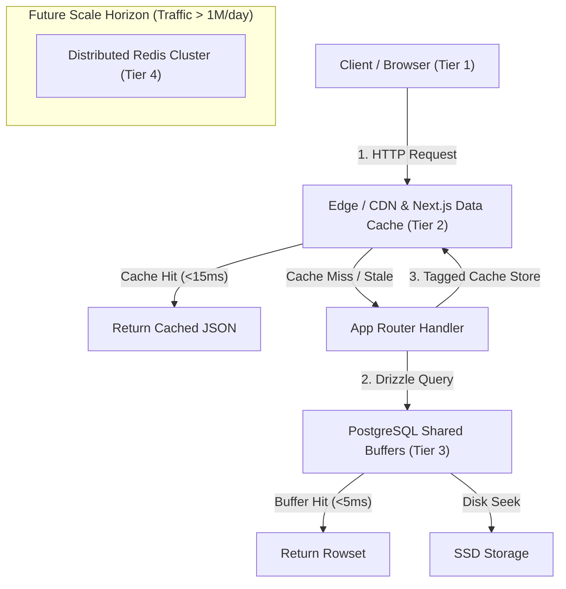

# System Architecture & Technical Specifications

## 1. Architecture Approach: Modular Monolith

The Islamic History Atlas is built as an App Router **modular monolith** in Next.js with TypeScript and PostgreSQL. A unified codebase eliminates cross-service network latency, ensures end-to-end type safety, avoids microservice operational overhead, and enables React Server Components to query the database with zero network hops.

---

## 2. Technology Stack & Decision Status

| Area | Technology Selected | Decision Status & Rationale |
|---|---|---|
| **Framework & Runtime** | Next.js 14 (App Router) + TypeScript 5 (Strict) | **Accepted (ADR-001):** Unified full-stack architecture, SSR, SSG, dynamic route handlers. |
| **Styling & Design System** | Tailwind CSS (Archival theme: parchment, ink, gold) | **Accepted:** Tokenized palette adhering to WCAG 2.2 AA contrast requirements. |
| **Interactive Cartography** | Leaflet with GeoJSON vector styling | **Accepted (ADR-004):** Lightweight, accessible keyboard navigation, multi-layer toggling. |
| **Database** | PostgreSQL 16+ | **Accepted:** ACID relational consistency, PostGIS spatial support, JSONB document fields. |
| **ORM & Query Builder** | Drizzle ORM | **Accepted (ADR-003):** Zero-overhead TypeScript SQL builder with transparent query planning. |
| **Input Validation** | Zod | **Accepted:** Strict schema validation for all API query parameters and AI inquiry bodies. |
| **AI Integration** | OpenRouter API (Grounded historical scholar) | **Accepted:** Historiographically bounded prompting citing Kennedy, Bosworth, and al-Tabari. |
| **Caching Layer** | Next.js App Router Data Cache + PostgreSQL Buffers | **Accepted (ADR-006):** In-process multi-tier caching; **Redis postponed** until high traffic demands it. |
| **Rate Limiting** | In-Memory Sliding-Window Token Bucket | **Accepted (ADR-008):** Zero-infrastructure in-process rate limiting (60 read/min, 10 AI/min). |
| **Testing Engine** | Vitest | **Accepted:** Fast ESM test runner with automated schema, API, and unit test suites. |
| **Authentication** | Postponed | **Accepted (ADR-009):** Out of scope for current read-only educational release; reserved for future milestone. |

---

## 3. Modular Monolith Architecture

The application is structured into decoupled domain modules:

```text
src/
├── app/                      # Next.js App Router: public pages and REST API handlers
│   ├── api/
│   │   ├── territories/      # Temporal territory control slices
│   │   ├── events/           # Chronological battle, conquest, and treaty events
│   │   ├── polities/         # Dynastic directory and dynamic detail lookups
│   │   ├── rulers/           # Caliph and ruler reign records
│   │   ├── routes/           # Trade networks and pilgrimage highways
│   │   ├── monuments/        # Architectural landmarks and intellectual centers
│   │   ├── scholars/         # Golden Age polymaths and treatises
│   │   ├── campaigns/        # Military campaign vectors and expedition marches
│   │   ├── ai/inquire/       # Grounded scholarly AI inquiry endpoint
│   │   └── health/           # Observability health and readiness probe
│   ├── (catalog pages)/      # SSG and SSR directories (/polities, /rulers, /events, /routes, etc.)
│   └── page.tsx              # Interactive Atlas Explorer home
├── components/
│   ├── atlas/                # Inspection detail panels (Territory, Event, Route, Monument, Campaign)
│   ├── map/                  # HistoricalMap (Leaflet canvas with GeoJSON layers)
│   ├── timeline/             # YearSlider and temporal controls
│   └── layout/               # Header, Footer, navigation, and theme shells
├── lib/
│   ├── db/
│   │   ├── schema/           # Drizzle table definitions and relations
│   │   ├── index.ts          # Database client connection and schema registry
│   │   └── seed.ts           # Database migration and seed runner
│   ├── data/
│   │   └── historicalSeed.ts # Curated, evidence-backed historical fixtures
│   ├── api/
│   │   └── validators.ts     # Zod query schemas and rate limit configurations
│   ├── geo/
│   │   └── territoryUtils.ts # Pure geometry and temporal filtering algorithms
│   └── utils.ts              # Formatters, color mappings, and class mergers
└── tests/
    └── unit/                 # Vitest test suites (12 suites, 69+ tests)
```

---

## 4. Multi-Tier Caching Architecture

Because the atlas serves historical facts that do not mutate at runtime, caching is structured into distinct tiers to maximize throughput and eliminate redundant database queries:



### 4.1 Caching Tiers
1. **Tier 1 (Browser Cache):** HTTP headers `Cache-Control: public, max-age=1800, s-maxage=3600, stale-while-revalidate=86400` instruct user browsers to cache temporal map views and static entity pages. Conditional requests validate `ETag` headers, returning `304 Not Modified` with zero network body transfer.
2. **Tier 2 (Next.js App Router Data Cache):** Database queries are wrapped in Next.js `unstable_cache` with domain tags (`['territories', 'events', 'polities', 'routes', 'monuments', 'scholars', 'campaigns']`). Subsequent requests within cache lifetime resolve in-memory in <15ms without reaching PostgreSQL.
3. **Tier 3 (PostgreSQL Shared Buffers):** Active temporal index nodes and frequently requested tables (`polities`, `territory_periods`) reside permanently in PostgreSQL's native `shared_buffers` memory pool.
4. **Tier 4 (Future Redis Option):**
   - **Trigger:** Only when horizontal scaling across multiple independent container instances causes cache drift or edge invalidation bottlenecks.
   - **Current Status:** **Postponed.** Unnecessary during current phases; Next.js in-process caching provides identical performance without recurring cloud infrastructure costs.

---

## 5. Pagination Architecture

The API employs a dual pagination strategy balancing performance and user experience:

### 5.1 Keyset (Cursor-Based) Pagination
- **Target Collections:** Large, sequential datasets (historical events, territory periods, future source registers, audit logs).
- **Mechanism:** Records are ordered by a deterministic index tuple (e.g. `(event_year, id)`). Requests supply an opaque `cursor` token representing the last record of the prior page.
- **Query Structure:**
  ```sql
  SELECT * FROM historical_events
  WHERE (event_year, id) > ($cursor_year, $cursor_id)
  ORDER BY event_year ASC, id ASC
  LIMIT $limit + 1;
  ```
- **Performance Guarantee:** Employs an $O(1)$ B-Tree index seek. Query duration remains constant (<3ms) whether retrieving the 1st page or the 10,000th page.

### 5.2 Limit / Offset Pagination
- **Target Collections:** Small, discrete entity catalogs (`/api/polities`, `/api/rulers`, `/api/scholars`, `/api/monuments`, `/api/campaigns`).
- **Mechanism:** `LIMIT :limit OFFSET :offset`.
- **Performance Guarantee:** Because these curated catalogs contain fewer than 100 entries, the scan overhead is negligible (<1ms) while granting users intuitive page-number controls ("Page 1 of 3").

---

## 6. Security, Rate Limiting & Authentication Policy

### 6.1 Zero-Infrastructure In-Memory Rate Limiting
To defend against automated scrapers, denial-of-service spikes, and LLM token exhaustion, rate limiting is implemented directly in the application runtime via an LRU sliding-window token bucket:
- **General Read Routes:** `60 requests / minute` per client IP.
- **AI Scholar Endpoint (`/api/ai/inquire`):** `10 requests / minute` per client IP.
- **Headers Returned:** `X-RateLimit-Limit`, `X-RateLimit-Remaining`, `X-RateLimit-Reset`.
- **Breach Response:** HTTP `429 Too Many Requests` with `Retry-After: <seconds>`.

### 6.2 Secret Hygiene
- Sensitive API keys (`OPENROUTER_API_KEY`) and database credentials (`DATABASE_URL`) are strictly restricted to server-side execution.
- Never exposed via `NEXT_PUBLIC_` prefixes or committed to version control (`.env.local` is enforced in `.gitignore`).

### 6.3 Authentication Policy
> [!IMPORTANT]
> **Authentication is explicitly out of scope and postponed.**
> As codified in ADR-009, the Islamic History Atlas is an open educational resource. All current functionality consists of public read operations. User authentication, session tokens, and role-based permissions are strictly reserved for a separate future Admin & Editorial milestone.

---

## 7. Performance & Query Optimization

1. **Database Indexing:**
   - B-Tree indexes on all temporal bounds (`valid_from_year`, `valid_to_year`, `start_year`, `end_year`).
   - Composite temporal indexes for interval overlap queries (`valid_from_year <= Y AND valid_to_year >= Y`).
   - Foreign key indexes on all relational joins.
   - Trigram GIN indexes (`pg_trgm`) for fuzzy text searches.
2. **GeoJSON Optimization:**
   - Coordinate precision truncated to 4 decimal places ($\pm 11\text{m}$ precision), reducing JSON transmission payloads by over 40%.
   - Gzip and Brotli compression enabled across all route responses.
3. **Sparse Projections:**
   - Directory listings omit heavy descriptive essays and return metadata fields only. Full text and complete geometries are retrieved on single-item detail queries (`/:id`).

---

## 8. Monitoring, Observability & Health Probing

Operational health and API performance are monitored through three complementary layers:

### 8.1 Health & Readiness Probe (`GET /api/health`)
A dedicated health endpoint monitors infrastructure status:
- Tests live database round-trip query execution (`SELECT 1`).
- Inspects Node.js runtime memory usage (`process.memoryUsage()`).
- Returns `200 OK` when healthy:
  ```json
  {
    "status": "healthy",
    "timestamp": "2026-11-09T00:15:00.000Z",
    "uptimeSeconds": 1420,
    "database": { "status": "connected", "latencyMs": 3 },
    "memory": { "rssMb": 84, "heapUsedMb": 48 }
  }
  ```

### 8.2 Structured Operational Logging
All route handlers emit structured JSON logs with standardized fields:
- `timestamp`: ISO-8601 UTC timestamp.
- `level`: `INFO`, `WARN`, `ERROR`.
- `requestId`: Unique request trace identifier.
- `method` & `path`: HTTP verb and request URL.
- `durationMs`: Total server-side execution duration.
- `statusCode`: HTTP status code returned to client.

### 8.3 Performance Metrics & Latency Tracking
- **Percentile Targets:** p50 < 30ms, p95 < 100ms, p99 < 250ms for cached read requests.
- **Alerting Thresholds:**
  - Sustained 5xx error rate > 1% over 5 minutes.
  - p95 latency > 500ms on temporal cartography endpoints.
  - Rate limit breach rate > 50 per minute (indicating automated scraping or DDoS attack).
